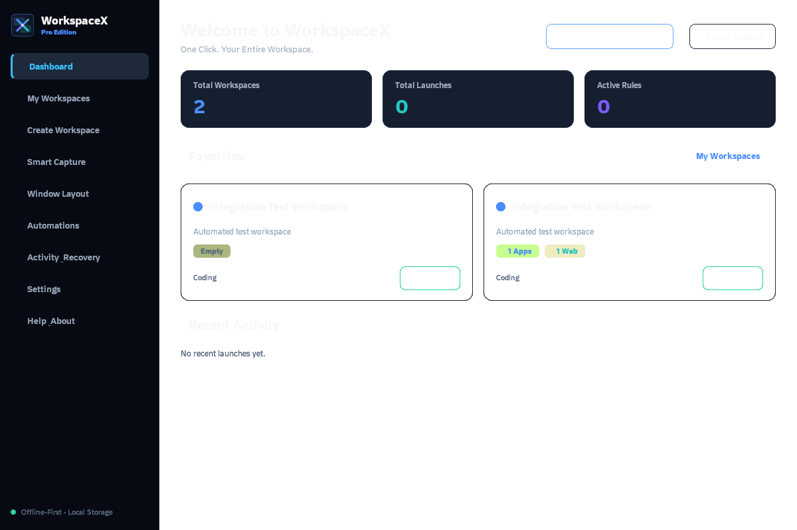
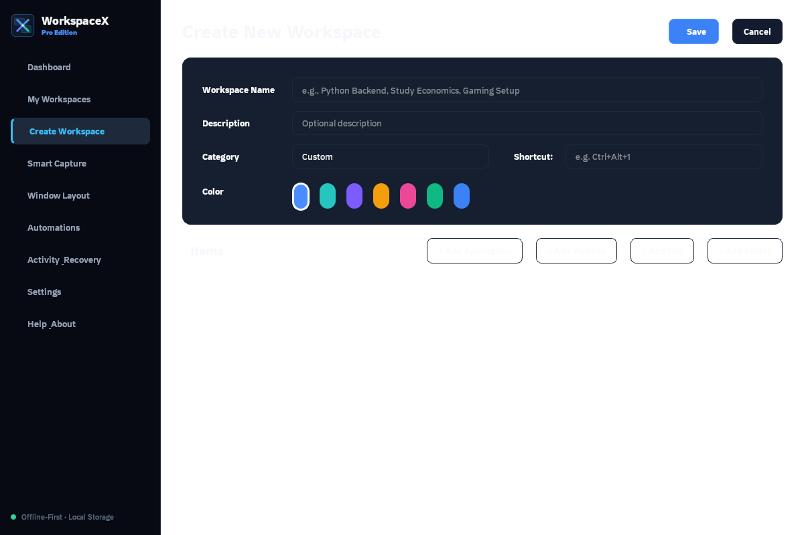
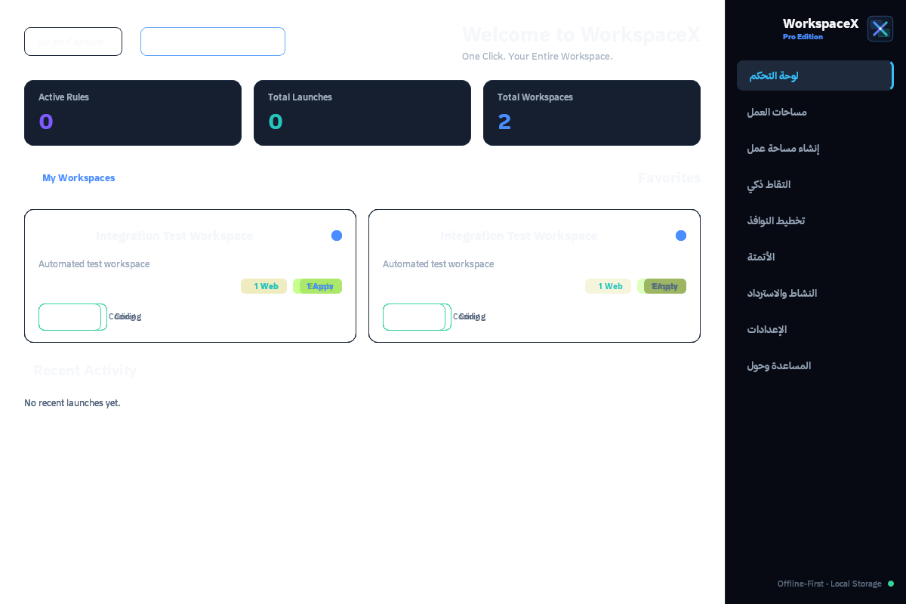

<div align="center">

# WorkspaceX

**مساحة عملك، جاهزة للانطلاق.**<br>
**Your workspace, ready to launch.**

اجمع تطبيقاتك ومواقعك وملفاتك في مساحات عمل على Windows.<br>
Organize your Windows apps, websites, and files into reusable workspaces.

[](https://github.com/HAX1122/WorkspaceX/releases/tag/v1.0.0)


[](https://github.com/HAX1122/WorkspaceX/issues)

**[تحميل المُثبّت · Download installer](https://github.com/HAX1122/WorkspaceX/releases/download/v1.0.0/Workspacex.exe)** · [الإصدار · Release notes](https://github.com/HAX1122/WorkspaceX/releases/tag/v1.0.0)

[العربية](#arabic) · [English](#english) · [الصور · Screenshots](#screenshots) · [SHA-256](#integrity)

</div>

---

<a id="arabic"></a>

<div dir="rtl">

## العربية

### ما هو WorkspaceX؟

WorkspaceX برنامج مكتبي لتنظيم بيئة العمل على Windows. أنشئ مساحة تضم البرامج والمواقع والملفات والمجلدات التي تستخدمها معًا، ثم شغّل عناصرها من مكان واحد. يتضمن التقاط النوافذ المفتوحة وحفظ معلومات مواضعها، وأدوات لتخطيط النوافذ والأتمتة.

### المميزات

- **إدارة المساحات:** إنشاء وتعديل مساحات العمل، وتنظيم عناصرها، والبحث والوصول إلى المفضلة.
- **تشغيل منظم:** فتح التطبيقات والمواقع والملفات والمجلدات بالتتابع، مع تأخير قابل للضبط وعرض نتيجة كل خطوة.
- **التقاط ذكي:** اكتشاف النوافذ المفتوحة ومسارات تطبيقاتها ومعلومات مواضعها لإنشاء مساحة عمل؛ راجع العناصر قبل حفظها.
- **تخطيط النوافذ:** حفظ مواضع النوافذ وأحجامها والعمل مع عدة شاشات، ضمن حدود Windows والتطبيق المستهدف.
- **أتمتة واختصارات:** اختصارات عامة ومواعيد تشغيل؛ يجب أن يبقى WorkspaceX قيد التشغيل لتعمل المواعيد والاختصارات.
- **بيانات محلية:** تخزين SQLite، واستيراد وتصدير المساحات، ونسخ احتياطي واستعادة، وسجل نتائج التشغيل.
- **خيارات الواجهة:** العربية والإنجليزية، واتجاه من اليمين إلى اليسار للعربية، ومظهر داكن أو فاتح. قد تظهر بعض التسميات بالإنجليزية.

### متطلبات Windows

| المتطلب | التفاصيل |
| :--- | :--- |
| النظام المستهدف | Windows 10 أو Windows 11، بمعمارية x64 |
| حزمة التحميل | `Workspacex.exe` — مُثبّت Windows، حجمه 35,322,869 بايت (حوالي 33.69 MiB) |
| Python | لا يلزم تثبيته لاستخدام حزمة البرنامج |
| التطبيقات والملفات | التطبيقات المطلوبة مثبتة، ومسارات الملفات والمجلدات صالحة |
| الإنترنت | مطلوب للتنزيل وفحص التحديثات وفتح المواقع؛ إدارة المساحات وتخزينها محليان |

لم تُتحقق بصورة مستقلة حدود دنيا للذاكرة أو مساحة التثبيت أو رقم بناء Windows؛ لذلك لا تُنشر تقديرات كمتطلبات مؤكدة. لا توجد حزمة Windows ‏32-bit أو macOS أو Linux ضمن هذا الإصدار.

### التحميل والتثبيت

1. افتح [الإصدار v1.0.0](https://github.com/HAX1122/WorkspaceX/releases/tag/v1.0.0)، ثم من **Assets** حمّل [Workspacex.exe](https://github.com/HAX1122/WorkspaceX/releases/download/v1.0.0/Workspacex.exe).
2. تحقق من بصمة الملف باستخدام قسم [التحقق من التنزيل](#integrity) أدناه.
3. افتح `Workspacex.exe`، واختر لغة المُثبّت، ثم اتبع معالج التثبيت وحدد موقع التثبيت المناسب.
4. شغّل **WorkspaceX** من قائمة ابدأ، أو من اختصار سطح المكتب إذا اخترت إنشاءه أثناء التثبيت.
5. أنشئ مساحة عمل، وأضف عناصرها، واحفظها، ثم اضغط **تشغيل / Launch**. يمكنك أيضًا التقاط النوافذ المفتوحة ومراجعة النتائج.

**نوع الملف:** `Workspacex.exe` هو المُثبّت؛ و`WorkspaceX.exe` داخل مجلد التثبيت هو البرنامج نفسه. لا تتوفر حزمة portable مستقلة ضمن مرفقات v1.0.0 المنشورة. أرشيفا **Source code** اللذان ينشئهما GitHub تلقائيًا ليسا مُثبّتًا ولا يحتويان على مصدر التطبيق الكامل في هذا المستودع.

### الأمان والخصوصية

- تُحفظ قاعدة البيانات افتراضيًا في `%LOCALAPPDATA%\WorkspaceX\workspacex.db`، والنسخ الاحتياطية في `%LOCALAPPDATA%\WorkspaceX\backups`. يستخدم المشروع SQLite عاديًا؛ لا يُفترض أن البيانات مشفرة.
- قد تتضمن المساحات والسجلات والملفات المصدّرة أسماء النوافذ ومسارات الملفات وعناوين المواقع. تُظهر ملفات الالتقاط المحلية المتاحة أيضًا قراءة سجل بعض متصفحات Chromium لاستخراج عناوين الصفحات الحديثة. راجع النتائج ولا تشارك قواعد البيانات أو النسخ الاحتياطية دون تنقيح.
- يتصل فحص التحديثات بخدمة GitHub افتراضيًا، أو بمصدر التحديث الذي تضبطه. فتح المواقع يشغّل المتصفح ويتصل بالموقع؛ لذلك لا يُوصف البرنامج بأنه بلا اتصال شبكي مطلقًا.
- ملف هذا الإصدار **غير موقّع رقميًا بتوقيع Authenticode** عند فحصه. إذا ظهر تحذير من Windows، تحقق من المصدر والبصمة قبل اتخاذ قرار التشغيل، ولا تعطّل وسائل الحماية.
- استورد مساحات من مصادر تثق بها، وافحص التطبيقات والمسارات والروابط قبل تشغيلها. مطابقة SHA-256 تثبت مطابقة الملف المنشور، ولا تُعد شهادة أمان.

### حدود الاستعادة

تعيد الاستعادة تشغيل العناصر وتحاول وضع النوافذ؛ لا تستعيد محتوى المستندات غير المحفوظ أو جميع حالات الجلسات. قد تختلف النتائج مع التطبيقات ذات صلاحيات المسؤول، وتطبيقات المتجر، وتغير الشاشات أو المسارات. لا يُضمن التقاط كل تبويب أو استعادة كل نافذة بالموقع نفسه.

### التحديثات والإبلاغ عن المشكلات

راجع [أحدث إصدار](https://github.com/HAX1122/WorkspaceX/releases/latest) وملاحظاته قبل التحديث، وخذ نسخة احتياطية أولًا. تتضمن الإعدادات فحصًا للتحديثات؛ ويمكن تنزيل المُثبّت من صفحة الإصدار وتشغيله بعد إغلاق البرنامج.

للإبلاغ عن خلل أو اقتراح ميزة، افتح [تذكرة جديدة](https://github.com/HAX1122/WorkspaceX/issues/new). أرفق إصدار البرنامج وWindows، وخطوات إعادة المشكلة، والنتيجة المتوقعة والفعلية. احذف البيانات الشخصية والمسارات الخاصة والرموز السرية من الصور والسجلات. لا تنشر تفاصيل أمنية حساسة في تذكرة عامة؛ اطلب وسيلة تواصل خاصة أولًا.

</div>

---

<a id="english"></a>

## English

### What is WorkspaceX?

WorkspaceX is a Windows desktop workspace organizer. Group the applications, websites, files, and folders you use together, then launch them from one place. It includes open-window capture, saved window placement, layout tools, and automation controls.

### Features

- **Workspace management:** create and edit workspaces, organize items, search, and access favorites.
- **Ordered launching:** open apps, websites, files, and folders in sequence, with configurable delays and per-item results.
- **Smart Capture:** detect open windows, application paths, and placement information to build a workspace; review results before saving.
- **Window layouts:** save window positions and sizes across multiple monitors, subject to Windows and application limitations.
- **Automation and shortcuts:** global keyboard shortcuts and scheduled launches. WorkspaceX must remain running for schedules and hotkeys to work.
- **Local data:** SQLite storage, workspace import/export, backup and restore, and launch history.
- **Interface options:** Arabic and English, right-to-left layout for Arabic, and dark/light themes. Some labels may remain in English.

### Windows requirements

| Requirement | Details |
| :--- | :--- |
| Target system | Windows 10 or Windows 11, x64 |
| Download | `Workspacex.exe` — Windows installer, 35,322,869 bytes (about 33.69 MiB) |
| Python | No separate Python installation is needed for the packaged application |
| Apps and files | Referenced applications must be installed; file and folder paths must remain valid |
| Internet | Needed for downloads, update checks, and websites; workspace management and storage are local |

Minimum RAM, installed disk space, and the minimum Windows build have not been independently verified; estimates are not presented as confirmed requirements. This release does not include a 32-bit Windows, macOS, or Linux package.

### Download and install

1. Open [v1.0.0](https://github.com/HAX1122/WorkspaceX/releases/tag/v1.0.0) and download [Workspacex.exe](https://github.com/HAX1122/WorkspaceX/releases/download/v1.0.0/Workspacex.exe) under **Assets**.
2. Compare its hash using [Download verification](#integrity) below.
3. Open `Workspacex.exe`, choose the installer language, and follow the setup wizard to select an installation location.
4. Open **WorkspaceX** from the Start menu, or from the desktop shortcut if you chose to create one.
5. Create a workspace, add its items, save, and select **Launch**. Alternatively, capture open windows and review the results.

**Package type:** `Workspacex.exe` is the installer; `WorkspaceX.exe` inside the installation folder is the application. The published v1.0.0 assets do not include a separate portable package. GitHub's automatically generated **Source code** archives are not installers and do not contain the complete application source in this repository.

### Security and privacy

- The default database is `%LOCALAPPDATA%\WorkspaceX\workspacex.db`; backups are stored in `%LOCALAPPDATA%\WorkspaceX\backups`. The project uses ordinary SQLite storage; do not assume encryption at rest.
- Workspaces, logs, and exports can contain window titles, file paths, and website URLs. The available local capture implementation also reads history from some Chromium browsers to resolve recent page URLs. Review captured items and redact databases or backups before sharing.
- Update checks contact GitHub by default, or the update source you configure. Opening websites launches a browser and contacts those sites. The application is therefore not described as completely network-free.
- The inspected release file is **not Authenticode-signed**. If Windows displays a warning, verify the source and hash before deciding whether to run it; do not disable security protections.
- Import workspaces only from sources you trust, and review apps, paths, and URLs before launching. A matching SHA-256 confirms that the file matches the published artifact; it is not a security certification.

### Restoration limits

Restoration launches items and attempts to position their windows. It does not recover unsaved document contents or every application's session state. Results can vary for elevated applications, Store apps, changed monitor arrangements, or moved files. Capturing every browser tab or restoring every window exactly is not guaranteed.

### Updates and issue reports

Check the [latest release](https://github.com/HAX1122/WorkspaceX/releases/latest) and its notes, and create a backup before updating. Settings includes an update check; you can also download the installer from the release page and run it after closing the application.

To report a bug or suggest a feature, [open an issue](https://github.com/HAX1122/WorkspaceX/issues/new). Include the application and Windows versions, reproduction steps, expected behavior, and actual behavior. Remove personal information, private paths, and secrets from screenshots and logs. Do not disclose sensitive security details in a public issue; request a private reporting channel first.

---

<a id="screenshots"></a>

## صور الواجهة · Screenshots

لقطات فعلية محفوظة في ملفات المشروع، ببيانات تجريبية. قد يختلف المظهر عن الحزمة المثبتة.<br>
Existing application screenshots from the project files, using sample data. Appearance may differ from the installed build.

### لوحة التحكم · Dashboard



<details>
<summary>إنشاء مساحة عمل · Workspace editor</summary>



</details>

<details>
<summary>الواجهة باتجاه عربي · Arabic layout</summary>



</details>

---

<a id="integrity"></a>

## التحقق من التنزيل · Download verification

لملف **Workspacex.exe** المنشور مع **v1.0.0**، شغّل الأمر التالي في PowerShell من مجلد التنزيل وقارن النتيجة:<br>
For **Workspacex.exe** from **v1.0.0**, run this in PowerShell from the download folder and compare the result:

```powershell
Get-FileHash -LiteralPath .\Workspacex.exe -Algorithm SHA256
```

```text
52d8ae466c1390372ae3a963286517bcb7e3b5a7e8ec5887077a23e175981e48
```

البصمة مطابقة لبيانات مرفق الإصدار ونسخة الملف التي فُحصت.<br>
This hash matches the release asset metadata and the inspected copy of the file.

### نطاق التوثيق · Documentation scope

أُعد هذا الدليل من ملفات المشروع المحلية المتاحة وصور واجهته وبيانات الإصدار المنشور. يصف الإمكانات الموجودة في الملفات التي روجعت؛ ولا يُعد تقرير اختبار شاملًا لكل ميزة في الملف التنفيذي. لا يتضمن المستودع حاليًا المصدر الكامل للتطبيق، ولا تُعلن هنا رخصة للمصدر أو نتائج اختبارات غير متحقق منها.

This guide is based on the available local project files, existing UI screenshots, and published release metadata. It describes capabilities present in the reviewed files, rather than certifying end-to-end testing of every feature in the executable. This repository does not currently contain the complete application source; no source license or unverified test results are asserted here.
